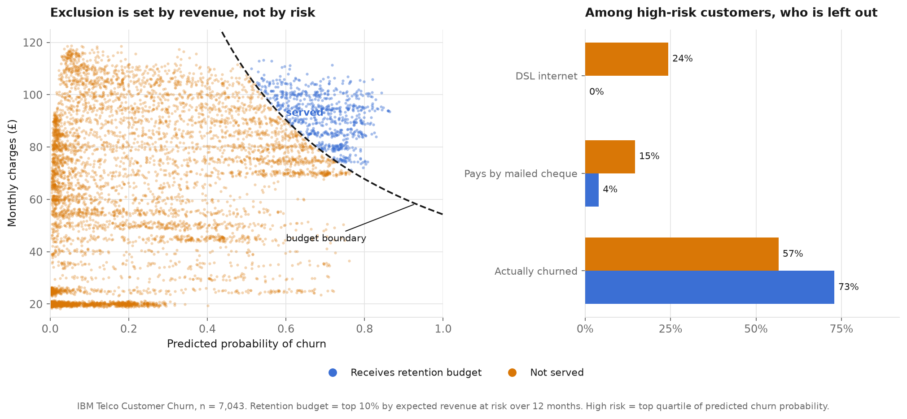

# Customer Retention Prioritisation and Its Distributional Consequences

A pilot study on the IBM Telco Customer Churn dataset (n = 7,043), asking a
question most churn analyses do not: when a firm allocates a limited retention
budget by predicted customer value, who does that allocation leave out, and are
those customers systematically different from those it serves?

## Motivation

Churn modelling is usually evaluated on predictive accuracy. But a churn model
is rarely the end product. It feeds a resource allocation decision, and that
decision determines which customers receive retention effort and which do not.

Customer prioritisation is well established in marketing. Homburg, Droll and
Totzek (2008, *Journal of Marketing*) showed across 310 firms that it raises
profitability without measurably damaging relationships with lower-tier
customers. That finding was produced when prioritisation was periodic, coarse
and implemented by managers. This pilot asks what the same logic looks like
when the ranking comes from a model.

## Data

Telco Customer Churn (IBM, public). 7,043 customers, 21 variables, 26.5% churn
rate. `TotalCharges` is stored as text and blank for customers with zero
tenure; it is coerced to numeric and filled with zero, which is the correct
value rather than an imputation.

## Method

**1. Predict churn.** Logistic regression, random forest and histogram
gradient boosting, each in a pipeline with standardisation and one-hot
encoding, evaluated by 5-fold stratified cross-validation with out-of-fold
predictions.

| Model | ROC-AUC | PR-AUC | vs base rate |
|---|---|---|---|
| Logistic Regression | 0.845 | 0.654 | 2.46× |
| Random Forest | 0.843 | 0.654 | 2.46× |
| Gradient Boosting | 0.825 | 0.622 | 2.34× |

Logistic regression is competitive with the ensembles, which is worth stating
plainly rather than reaching for the more complex model.

**2. Rank by expected revenue at risk.** A firm allocating a retention budget
does not target the customers most likely to leave. It targets those whose
departure costs most. Expected revenue at risk is the predicted churn
probability multiplied by monthly charges over a twelve-month horizon.

**3. Allocate and examine the remainder.** A budget covering the top 10% of
customers by expected value is applied, and the customers in the top quartile
of churn risk who fall outside it are compared with those inside.

## Findings



At a 10% budget, **60% of high-risk customers receive no retention effort**.
Comparing high-risk customers served against high-risk customers not served:

| | Served | Not served |
|---|---|---|
| Monthly charges | £91.90 | £71.20 |
| Actual churn rate | 72.9% | 56.6% |
| Tenure (months) | 12.6 | 11.4 |
| Pays by mailed cheque | 4.0% | 14.6% |
| DSL internet | 0.0% | 24.3% |

Two results stand out.

**No DSL customer at high churn risk receives retention effort under any
realistic budget.** Service tier alone determines it: DSL customers cannot
generate enough revenue to clear the threshold whatever their risk. The
exclusion is total up to a budget covering 15% of the base, and only breaks
down once the budget passes roughly a fifth:

| Budget | DSL among served high-risk |
|---|---|
| 5% | 0.0% |
| 10% | 0.0% |
| 15% | 0.0% |
| 20% | 0.1% |
| 30% | 5.3% |
| 40% | 11.2% |

**Customers who pay by mailed cheque are over-represented among the excluded by
a factor of 3.6.** Payment method is not in any sense a measure of customer
worth, but it correlates with the revenue measures that are.

The exclusion is not a prediction failure. The model identified these customers
correctly. They were deprioritised because the revenue they represent does not
justify the cost of retaining them, which is prioritisation working as
intended.

## Limitations

This pilot establishes that the deprioritised group exists, is large and is
systematically different. It cannot establish what happens next.

- The allocation is simulated, not observed. No firm actually ran this campaign.
- There is no post-allocation outcome data, so the consequences of exclusion
  cannot be measured.
- A single cross-section cannot identify a feedback loop between treatment and
  subsequent behaviour. That requires panel data and a credible identification
  strategy.
- Expected revenue at risk uses a fixed twelve-month horizon and ignores
  variation in margin across service tiers.

## Running it

```bash
pip install -r requirements.txt
bash get_data.sh                  # downloads the dataset to churn_data/
python -I churn_prioritisation.py # models, allocation, distributional analysis
python -I make_figure.py          # produces outputs/exclusion.png
```

The dataset is not committed to this repository. `get_data.sh` fetches it from
IBM's public mirror.

## Repository layout

```
churn_prioritisation.py   models, allocation simulation, distributional analysis
make_figure.py            the figure above
get_data.sh               fetches the dataset
outputs/                  results as CSV, plus the figure
```

## Reference

Homburg, C., Droll, M., & Totzek, D. (2008). Customer prioritization: Does it
pay off, and how should it be implemented? *Journal of Marketing*, 72(5),
110–130. https://doi.org/10.1509/jmkg.72.5.110
